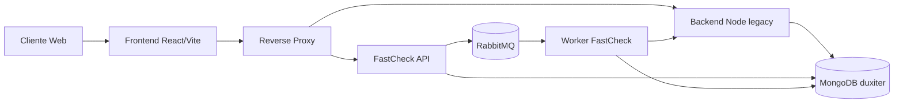

# Estructura de la Plataforma Tecnológica de Duxiter

## Resumen Ejecutivo

Duxiter es una plataforma integral de evaluación y monitoreo empresarial construida con una arquitectura moderna, escalable y basada en la nube. La plataforma combina tecnologías de vanguardia incluyendo inteligencia artificial, APIs de terceros, y una arquitectura orientada a servicios para proporcionar evaluaciones de riesgo empresarial en tiempo real.

En paralelo al backend histórico en Node.js, existe un backend adicional llamado **FastCheck API** implementado en **Python/FastAPI**. Este servicio está pensado como **API producto (SaaS)** para clientes, y corre en paralelo sin reemplazar el backend existente. La regla principal de compatibilidad es que **reutiliza la base de datos MongoDB existente `duxiter` y las colecciones actuales** para autenticación, usuarios, tenants y datos funcionales (sin esquemas paralelos).

## 1. Arquitectura General

### 1.1 Arquitectura de Aplicación
- **Tipo**: Full-Stack separado (Frontend + Backend)
- **Patrón**: Arquitectura de 3 capas (Presentación, Lógica de Negocio, Datos)
- **Comunicación**: API RESTful con autenticación JWT
- **Documentación API**: Swagger/OpenAPI 3.0
- **Estrategia de backend en paralelo**:
  - **Backend Node.js (legacy / interno)**: fuente de verdad funcional y persistencia.
  - **FastCheck API (FastAPI / cliente)**: capa producto, minimalista, documentada y multi-tenant, adaptada al modelo de datos existente.

### 1.2 Modelo de Despliegue
- **Infraestructura**: Contenedores Docker
- **Proxy Reverso**: Nginx para balanceo de carga y enrutamiento
- **Base de Datos**: MongoDB con replicación
- **Cola de Mensajes**: RabbitMQ para procesamiento asíncrono
- **FastCheck API (FastAPI)**: puede desplegarse sin Docker (venv), y enrutar por prefijo vía Nginx (por ejemplo `/client-api-v1/*`).

## 2. Stack Tecnológico

### 2.1 Frontend
- **Framework**: React 18+ con TypeScript
- **Build Tool**: Vite (desarrollo y producción)
- **Estilos**: Tailwind CSS
- **Comunicación**: Axios para llamadas API
- **Enrutamiento**: React Router
- **Testing**: Jest

#### 2.1.1 Estructura frontend (alto nivel)
- **Entrypoints**: `src/main.tsx`, `src/index.tsx`
- **Rutas**: `src/routes/*` (enrutamiento de vistas)
- **Contextos**: `src/contexts/*` (auth, tenant, tema)
- **Servicios**: `src/services/*` (cliente API, servicios de dominio)
- **Componentes**: `src/components/*` (layouts, componentes comunes y Fast Check UI)

### 2.2 Backend
- **Runtime**: Node.js
- **Framework**: Express.js con TypeScript
- **ORM/ODM**: Mongoose para MongoDB
- **Autenticación**: JWT (JSON Web Tokens)
- **Seguridad**: Helmet, CORS, Rate Limiting
- **Documentación**: Swagger UI

### 2.3 FastCheck API (Python)
- **Framework**: FastAPI
- **Modelado**: Pydantic v2 (request/response como fuente de verdad para OpenAPI)
- **MongoDB**: Motor/PyMongo (conexión al mismo `MONGODB_URI` y misma DB `duxiter`)
- **Autenticación**: JWT compatible con el backend Node (mismo `VITE_JWT_SECRET` y payload)
- **Procesamiento asíncrono**: RabbitMQ (publicación/consumo) con tolerancia a degradación (si RabbitMQ no está disponible, la API puede iniciar sin procesamiento async)
- **Documentación**:
  - OpenAPI JSON: `/openapi.json` y también `{FASTCHECK_API_PREFIX}/openapi.json`
  - Swagger/ReDoc interno: `/internal/docs`, `/internal/redoc`
  - RapiDoc (customer docs): `/docs` y también `{FASTCHECK_API_PREFIX}/docs`

### 2.4 Base de Datos
- **Motor**: MongoDB 7.0
- **Características**:
  - Esquemas flexibles para datos empresariales complejos
  - Índices optimizados para consultas de rendimiento
  - Replicación para alta disponibilidad

### 2.5 Servicios de Infraestructura
- **Cola de Mensajes**: RabbitMQ 3.12 con interfaz de gestión
- **Proxy Reverso**: Nginx con compresión gzip y caché
- **Contenedores**: Docker Compose para orquestación

## 3. Inteligencia Artificial

### 3.1 Integración con OpenAI
- **Servicio**:  (Singleton Pattern)
- **Funcionalidades**:
  - Análisis automático de datos empresariales
  - Generación de resúmenes de riesgo en Markdown
  - Evaluación de parámetros empresariales
  - Extracción de información estructurada

### 3.2 Casos de Uso de IA
1. **Análisis de Datos **: Procesamiento de información legal y financiera
2. **Evaluación de Riesgos**: Análisis automático de parámetros empresariales
3. **Generación de Reportes**: Resúmenes ejecutivos automáticos
4. **Extracción de Datos**: Búsqueda inteligente en documentos JSON complejos

### 3.3 Configuración de IA
- **Prompts Configurables**: Sistema de plantillas de prompts personalizables
- **Logging Completo**: Registro de todas las operaciones de IA
- **Control de Tokens**: Gestión de límites y costos
- **Manejo de Errores**: Recuperación automática ante fallos

## 4. APIs e Integraciones

### 4.2 APIs Internas
- **Autenticación**: `/api/auth/*`
- **Gestión de Tenants**: `/api/tenant/*`
- **Evaluaciones**: `/api/evaluations/*`
- **Consultas RUT**: `/api/rut/*`
- **Monitoreo**: `/api/monitoring/*`
- **Notificaciones**: `/api/notifications/*`

### 4.3 FastCheck API (cliente)
La FastCheck API expone un subconjunto estable y orientado a clientes, manteniendo compatibilidad con el modelo persistente:
- **Auth**: `POST {FASTCHECK_API_PREFIX}/auth/login`, `POST {FASTCHECK_API_PREFIX}/auth/refresh`, `GET {FASTCHECK_API_PREFIX}/auth/me`
- **Checks**: `POST {FASTCHECK_API_PREFIX}/checks`, `GET {FASTCHECK_API_PREFIX}/checks`, `GET {FASTCHECK_API_PREFIX}/checks/{job_id}/results`
- **Reports**: `GET {FASTCHECK_API_PREFIX}/reports/fast-check/{rut}`
- **Usage**: `GET {FASTCHECK_API_PREFIX}/usage`, `GET {FASTCHECK_API_PREFIX}/usage/operations`

El prefijo `{FASTCHECK_API_PREFIX}` es configurable vía `.env` (por ejemplo `/client-api-v1`).

### 4.4 Integración con backend Node (adapter)
FastCheck API puede delegar procesamiento complejo al backend existente mediante una capa de integración (adapter) para:
- Ejecutar lookup/rut y lógica propietaria existente.
- Reutilizar generación de resúmenes/reportes ya implementados.
- Reducir duplicación de reglas de negocio en la capa producto.

## 5. Arquitectura Escalable

### 5.1 Escalabilidad Horizontal
- **Contenedores Docker**: Fácil replicación de servicios
- **Nginx Load Balancer**: Distribución de carga
- **MongoDB Sharding**: Particionamiento de datos
- **RabbitMQ Clustering**: Procesamiento distribuido

### 5.2 Escalabilidad Vertical
- **Optimización de Consultas**: Índices MongoDB optimizados
- **Caché de Aplicación**: Caché en memoria para datos frecuentes
- **Compresión**: Gzip para reducir transferencia de datos
- **Lazy Loading**: Carga diferida de componentes React

### 5.3 Microservicios
- **Servicio de Autenticación**: Gestión de usuarios y tokens
- **Servicio de Evaluaciones**: Lógica de negocio principal
- **Servicio de Notificaciones**: Alertas y comunicaciones
- **Servicio de Monitoreo**: Seguimiento de cambios de riesgo

## 6. Infraestructura en la Nube

### 6.1 Configuración de Contenedores
```yaml
Servicios Docker:
- MongoDB: Puerto 27017
- RabbitMQ: Puerto 5672 (AMQP) + 15672 (Management)
- Frontend: Puerto 5173 (Vite)
- Backend: Puerto 3000 (Express)
- Nginx: Puerto 80 (Proxy)
```

### 6.2 Configuración de Red
- **Red Docker**: `duxiter-network` (bridge)
- **Volúmenes Persistentes**: 
  - `mongodb_data`: Datos de base de datos
  - `rabbitmq_data`: Cola de mensajes
- **Variables de Entorno**: Configuración centralizada

### 6.3 Seguridad
- **Headers de Seguridad**: Helmet.js
- **CORS**: Configuración permisiva para desarrollo
- **Rate Limiting**: Protección contra ataques DDoS
- **Autenticación JWT**: Tokens seguros con expiración
- **Validación de Entrada**: Sanitización de datos

## 7. Monitoreo y Observabilidad

### 7.1 Logging
- **Logs de Aplicación**: Console logging estructurado
- **Logs de IA**: Registro completo de operaciones OpenAI
- **Logs de Errores**: Captura y almacenamiento de excepciones

### 7.2 Health Checks
- **Endpoint de Salud**: `http://localhost/health`
- **Health bajo prefijo**: `http://localhost{FASTCHECK_API_PREFIX}/health` (FastCheck API)
- **Monitoreo de Servicios**: Estado de MongoDB y RabbitMQ
- **Métricas de Rendimiento**: Tiempo de respuesta de APIs

### 7.3 Notificaciones
- **Alertas de Riesgo**: Notificaciones automáticas por email
- **Monitoreo Programado**: Verificaciones periódicas
- **Estados de Notificación**: Seguimiento de entrega

## 8. Gestión de Datos

### 8.1 Modelos de Datos Principales
- **Users**: Gestión de usuarios y roles
- **Tenants**: Organizaciones multi-tenant
- **CreditOperations**: Operaciones de crédito y facturación
- **RiskChangeNotifications**: Alertas de cambio de riesgo
- **AIOperationLog**: Registro de operaciones de IA

### 8.2 Compatibilidad de persistencia (FastCheck API)
FastCheck API **no define esquemas paralelos**. Reutiliza colecciones existentes en `duxiter`:
- **users** y **tenants** para auth, tenant lookup y control de acceso.
- **evaluationjobs** y **evaluationresults** para checks/jobs/resultados.
- **summaries** para reportes (FastCheck summary).
- **creditoperations** para uso/consumo de créditos.
- **consulta_history** para auditoría/trazabilidad.

Las reglas de compatibilidad priorizan:
- mismos nombres de campos,
- mismos tipos de identificadores (ObjectId vs string),
- misma semántica de roles/permissions derivada del `role` del usuario.

### 8.3 Diagrama (alto nivel)



### 8.4 Flujo de Datos
Notas de enrutamiento (fuera del diagrama, para evitar problemas de renderizado Mermaid):
- Reverse Proxy enruta `/api/*` hacia el backend Node (legacy).
- Reverse Proxy enruta `{FASTCHECK_API_PREFIX}/*` hacia FastCheck API (FastAPI).
1. **Ingesta**: APIs externas → MongoDB
2. **Procesamiento**: IA → Análisis → Resultados
3. **Almacenamiento**: Resultados → Base de datos
4. **Notificación**: Cambios → RabbitMQ → Email

## 9. Desarrollo y Despliegue

### 9.1 Entorno de Desarrollo
- **Hot Reload**: Vite para frontend, tsx watch para backend
- **Debugging**: Source maps y logging detallado
- **Testing**: Jest para pruebas unitarias
- **Linting**: ESLint para calidad de código

### 9.2 Proceso de Despliegue
1. **Build**: Compilación TypeScript y bundling
2. **Containerización**: Docker images
3. **Orquestación**: Docker Compose
4. **Proxy**: Nginx para enrutamiento
5. **Monitoreo**: Health checks y logs

## 10. Ventajas Competitivas Tecnológicas

### 10.1 Innovación
- **IA Integrada**: Análisis automático con OpenAI
- **Datos en Tiempo Real**: APIs  actualizadas
- **Multi-tenant**: Arquitectura escalable para múltiples organizaciones
- **Notificaciones Inteligentes**: Alertas automáticas de cambios de riesgo

### 10.2 Escalabilidad
- **Arquitectura de Microservicios**: Componentes independientes
- **Contenedores Docker**: Despliegue consistente
- **Base de Datos NoSQL**: Flexibilidad de esquemas
- **Cola de Mensajes**: Procesamiento asíncrono

### 10.3 Mantenibilidad
- **TypeScript**: Tipado estático para mayor robustez
- **Documentación API**: Swagger para desarrollo colaborativo
- **Logging Estructurado**: Debugging y monitoreo eficiente
- **Configuración Centralizada**: Variables de entorno

## 11. Equipo Ideal para la Infraestructura

### 11.1 Estructura del Equipo

Para gestionar eficientemente la infraestructura de Duxiter, se recomienda un equipo multidisciplinario con las siguientes especialidades:

#### **DevOps Engineer / Site Reliability Engineer (SRE)**
- **Responsabilidades**:
  - Gestión de contenedores Docker y orquestación
  - Configuración y mantenimiento de Nginx
  - Monitoreo de infraestructura y alertas
  - Automatización de despliegues (CI/CD)
  - Gestión de variables de entorno y secretos
- **Habilidades Técnicas**:
  - Docker, Docker Compose
  - Nginx, reverse proxy configuration
  - Linux system administration
  - Monitoring tools (Prometheus, Grafana)
  - Scripting (Bash, Python)

#### **Database Administrator (DBA)**
- **Responsabilidades**:
  - Administración de MongoDB clusters
  - Optimización de consultas y índices
  - Backup y recovery strategies
  - Monitoreo de rendimiento de base de datos
  - Gestión de replicación y sharding
- **Habilidades Técnicas**:
  - MongoDB administration
  - NoSQL database design
  - Performance tuning
  - Backup/restore procedures
  - Database security

#### **Cloud Infrastructure Engineer**
- **Responsabilidades**:
  - Diseño de arquitectura escalable
  - Gestión de servicios en la nube
  - Implementación de alta disponibilidad
  - Gestión de redes y seguridad
  - Cost optimization
- **Habilidades Técnicas**:
  - Cloud platforms (AWS, Azure, GCP)
  - Infrastructure as Code (Terraform, CloudFormation)
  - Networking and security
  - Load balancing and auto-scaling
  - Cost management

#### **Security Engineer**
- **Responsabilidades**:
  - Implementación de políticas de seguridad
  - Gestión de certificados SSL/TLS
  - Auditorías de seguridad
  - Gestión de accesos y autenticación
  - Compliance y regulaciones
- **Habilidades Técnicas**:
  - Security best practices
  - SSL/TLS configuration
  - JWT and OAuth implementation
  - Vulnerability assessment
  - Compliance frameworks

### 11.2 Roles de Desarrollo

#### **Full-Stack Developer**
- **Responsabilidades**:
  - Desarrollo y mantenimiento de APIs
  - Integración con servicios externos
  - Optimización de rendimiento
  - Testing y debugging
- **Habilidades Técnicas**:
  - Node.js, Express.js, TypeScript
  - React, TypeScript, Tailwind CSS
  - MongoDB, Mongoose
  - API design and integration

#### **AI/ML Engineer**
- **Responsabilidades**:
  - Integración y optimización de OpenAI
  - Desarrollo de prompts y configuraciones
  - Monitoreo de costos de IA
  - Análisis de datos y métricas
- **Habilidades Técnicas**:
  - OpenAI API integration
  - Prompt engineering
  - Data analysis
  - Machine learning concepts

### 11.3 Tamaño del Equipo por Fase

#### **Fase de Startup (1-3 personas)**
- 1 Full-Stack Developer con conocimientos DevOps
- 1 DevOps Engineer (part-time o consultor)

#### **Fase de Crecimiento (4-8 personas)**
- 2-3 Full-Stack Developers
- 1 DevOps Engineer dedicado
- 1 DBA (part-time o consultor)
- 1 AI/ML Engineer

#### **Fase de Escalamiento (8+ personas)**
- 3-4 Full-Stack Developers
- 1-2 DevOps Engineers
- 1 DBA dedicado
- 1 Cloud Infrastructure Engineer
- 1 Security Engineer
- 1-2 AI/ML Engineers

### 11.4 Herramientas y Procesos Recomendados

#### **Monitoreo y Observabilidad**
- **Application Monitoring**: New Relic, Datadog
- **Infrastructure Monitoring**: Prometheus + Grafana
- **Log Management**: ELK Stack (Elasticsearch, Logstash, Kibana)
- **Error Tracking**: Sentry

#### **CI/CD Pipeline**
- **Version Control**: Git (GitHub/GitLab)
- **CI/CD**: GitHub Actions, GitLab CI, Jenkins
- **Container Registry**: Docker Hub, AWS ECR
- **Deployment**: Docker Compose, Kubernetes

#### **Security Tools**
- **Vulnerability Scanning**: Snyk, OWASP ZAP
- **Secret Management**: HashiCorp Vault, AWS Secrets Manager
- **SSL/TLS**: Let's Encrypt, Cloudflare
- **Access Management**: Auth0, AWS IAM

### 11.5 Presupuesto Estimado (Mensual)

#### **Equipo Mínimo (Startup)**
- Full-Stack Developer: $4,000 - $8,000
- DevOps Consultant: $2,000 - $4,000
- **Total**: $6,000 - $12,000

#### **Equipo Medio (Crecimiento)**
- 2-3 Developers: $8,000 - $18,000
- DevOps Engineer: $5,000 - $9,000
- DBA Consultant: $1,500 - $3,000
- AI/ML Engineer: $5,000 - $10,000
- **Total**: $19,500 - $40,000

#### **Equipo Completo (Escalamiento)**
- 3-4 Developers: $12,000 - $24,000
- 1-2 DevOps Engineers: $8,000 - $16,000
- DBA: $4,000 - $8,000
- Cloud Engineer: $5,000 - $10,000
- Security Engineer: $5,000 - $10,000
- 1-2 AI/ML Engineers: $8,000 - $18,000
- **Total**: $42,000 - $86,000

### 11.6 Certificaciones Recomendadas

#### **Cloud Certifications**
- AWS Certified Solutions Architect
- Azure Solutions Architect Expert
- Google Cloud Professional Cloud Architect

#### **DevOps Certifications**
- Docker Certified Associate
- Kubernetes Administrator (CKA)
- HashiCorp Certified: Terraform Associate

#### **Security Certifications**
- Certified Information Systems Security Professional (CISSP)
- Certified Ethical Hacker (CEH)
- AWS Certified Security - Specialty

### 11.7 Plan de Capacitación

#### **Onboarding (Primeras 2 semanas)**
- Arquitectura de la plataforma Duxiter
- Configuración del entorno de desarrollo
- Procesos de despliegue y monitoreo
- Políticas de seguridad y compliance

#### **Capacitación Continua**
- Workshops mensuales sobre nuevas tecnologías
- Certificaciones anuales
- Conferencias y eventos de la industria
- Rotación de roles para conocimiento cruzado

---

**Versión del Documento**: 1.1  
**Fecha**: Enero 2025  
**Versión de la Plataforma**: 1.5.7
