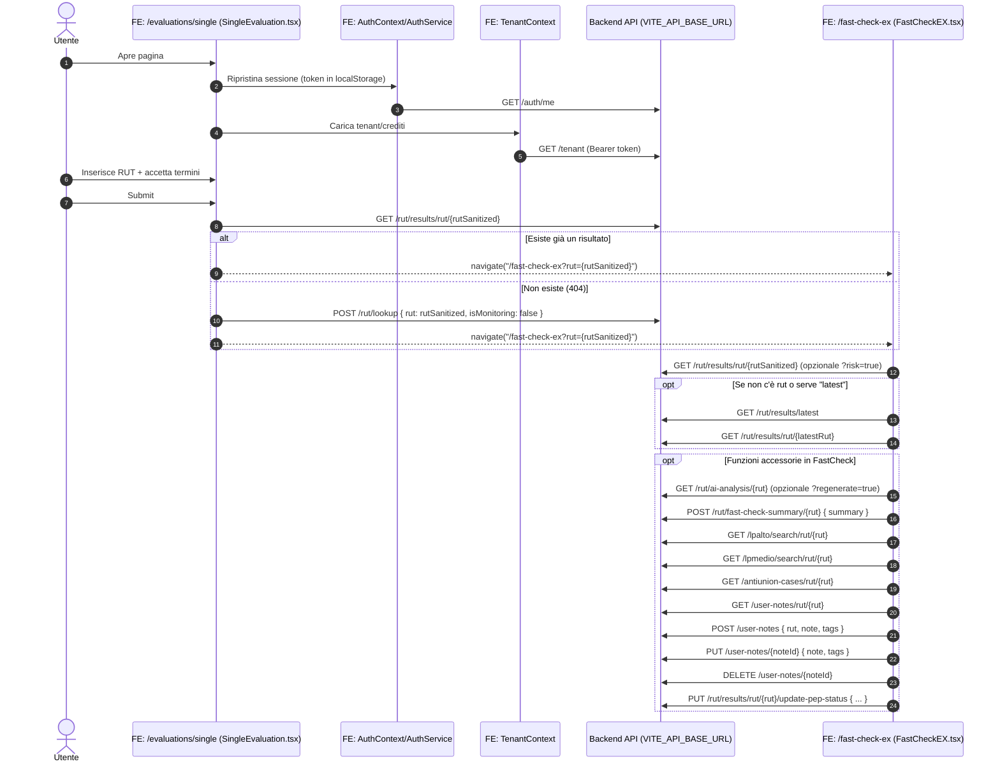

# SINGLE_EVALUATION_FLOW

## Scopo
Descrive il flusso frontend della funzionalità **Evaluación Individual** (route: `/evaluations/single`) e il passaggio alla pagina risultati **FastCheck** (route: `/fast-check-ex`), includendo le chiamate API effettuate dal frontend.

## Componenti coinvolti
- **UI form valutazione**: `src/pages/evaluations/SingleEvaluation.tsx`
- **Pagina risultati**: `src/pages/FastCheckEX.tsx`
- **Client HTTP**: `src/services/api.ts` (`apiClient`)
- **Auth**: `src/contexts/AuthContext.tsx` + `src/services/authService.ts`
- **Tenant/Crediti**: `src/contexts/TenantContext.tsx`

## Base URL API
Il frontend usa:
- `globalThis.__APP_ENV__?.VITE_API_BASE_URL`
- fallback: `https://duxiter.azurianlab.com/api`

Tutte le chiamate sotto sono relative a questa base URL.

## Flusso ad alto livello
1. L’utente apre **Evaluación Individual** (`/evaluations/single`)
2. Il frontend carica contesto sessione/tenant (token + crediti)
3. L’utente inserisce e conferma il **RUT** (validazione lato client + accettazione termini)
4. Alla submit:
   - controlla se esiste già un risultato in DB
   - se esiste: reindirizza direttamente a **FastCheck** con `rut` in querystring
   - se non esiste: avvia `lookup` e poi reindirizza a **FastCheck**
5. In **FastCheck** vengono caricati i dettagli del risultato e i dati “accessori” (AI analysis, liste, note, ecc.)

## Normalizzazione RUT (frontend)
- Durante digitazione il RUT viene formattato.
- Prima delle API, il RUT viene “sanitizzato” togliendo i punti: `formattedRut.replace(/\./g, '')`
- L’hyphen rimane (es. `12.345.678-9` → `12345678-9`)

## Diagramma (sequenza)

## Chiamate API per “Evaluación Individual” (pagina `/evaluations/single`)
Chiamate direttamente collegate al submit:

1. **Controllo esistenza risultato**
- `GET /rut/results/rut/{rut}`
  - Se risponde con dati: considerato “già esistente” → redirect a FastCheck
  - Se 404: procede con `lookup`

2. **Avvio valutazione**
- `POST /rut/lookup`
  - Body: `{ "rut": "{rut}", "isMonitoring": false }`
  - In seguito redirect a FastCheck

## Chiamate “di contesto” (sessione/tenant)
Queste possono avvenire mentre l’utente è su `/evaluations/single`:

- `GET /auth/me` (ripristino sessione)
- `GET /tenant` (crediti/tenant; header `Authorization: Bearer <token>`)

## Caricamento risultati (pagina `/fast-check-ex`)
FastCheck usa tipicamente questi endpoint per mostrare il risultato della valutazione:

- `GET /rut/results/rut/{rut}` (opzionale `?risk=true`)
- `GET /rut/results/{resultId}` (opzionale `?risk=true`)
- `GET /rut/results/latest`

In base alle feature attive in UI, possono aggiungersi:
- `GET /rut/ai-analysis/{rut}` (opzionale `?regenerate=true`)
- `POST /rut/fast-check-summary/{rut}`
- `GET /lpalto/search/rut/{rut}`
- `GET /lpmedio/search/rut/{rut}`
- `GET /antiunion-cases/rut/{rut}`
- Note utente:
  - `GET /user-notes/rut/{rut}`
  - `POST /user-notes`
  - `PUT /user-notes/{noteId}`
  - `DELETE /user-notes/{noteId}`
- Aggiornamento stato PEP:
  - `PUT /rut/results/rut/{rut}/update-pep-status`

## Stati e UX (sintesi)
- Submit bloccato se:
  - RUT non valido
  - termini non accettati
  - loading in corso
- Se crediti tenant = 0: viene mostrato un dialog informativo.
- In caso di errore non-404 nel check esistenza: viene loggato ma il flusso continua con `lookup`.

## Note operative
- Il redirect a `/fast-check-ex` è parte integrante del flusso: la pagina “Evaluación Individual” funge da avvio/trigger, mentre la visualizzazione del risultato avviene in FastCheck.
