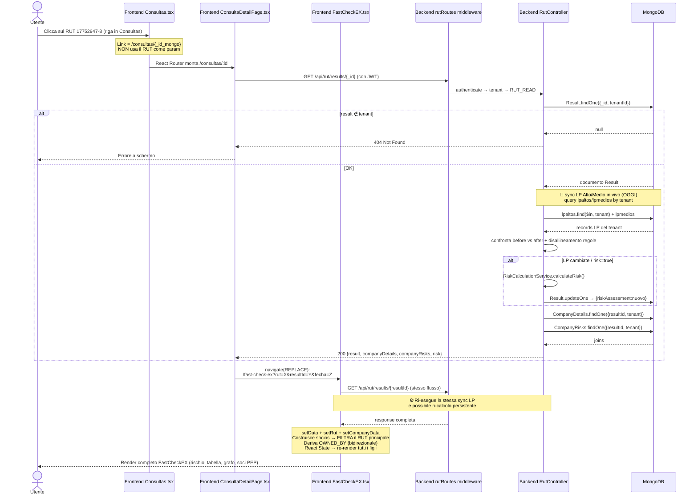

# Flusso: Click sul RUT nella pagina Consultas

> Ultimo aggiornamento: 30.09.2026 · Autore: Duxiter Intermediate Team
> Diagramma end-to-end del percorso: dal click dell'utente su un RUT nella tabella "Consultas" fino al rendering completo in FastCheckEX con ri-sincronizzazione delle Liste Proprie e ri-calcolo del rischio.

---

## 🔁 Riassunto Esecutivo (1 riga)

```
Click sul RUT → <Link to=/consultas/{_id}> → ConsultaDetailPage
             → GET /api/rut/results/{_id} (middleware tenant + permission)
             → navigate(replace) verso /fast-check-ex?rut={RUT}&resultId={_id}&fecha={createdAt}
             → FastCheckEX usa resultId, rifà la fetch, autosinc LP Alto/Medio
             → ri-calcolo riskAssessment se LP cambiate → persistenza DB
             → render completo + Socios Storici (senza il RUT principale)
```

---

## 📑 FASE 1 · Pagina Consultas (frontend)

**File:** [Consultas.tsx](file:///home/duxiter/duxiter_intermediate/src/pages/Consultas.tsx)

| # | Passo | Dettaglio | Localizzazione |
|---|-------|-----------|----------------|
| 1.1 | Caricamento iniziale paginato | `useEffect` → `getResults({page, limit, search})` restituisce 20 righe per pagina dalla collezione `results` (solo tenant corrente). | [L506-L540](file:///home/duxiter/duxiter_intermediate/src/pages/Consultas.tsx#L506-L540) |
| 1.2 | Ricerca RUT | `cleanRutForApi()`: se l'input di ricerca contiene `-`, invia solo il corpo al backend (senza DV) per massimizzare gli hit. | [L39-L47](file:///home/duxiter/duxiter_intermediate/src/pages/Consultas.tsx#L39-L47) |
| 1.3 | **Render del link** | ⚠️ Il `<Link>` NON usa il RUT come parametro di rotta. Usa l'`_id` mongo del documento Result. Due punti di ingresso con destinazione identica: **cella RUT** (sottolineata) e **icona occhio 👁 in Azioni**. | [L1070-L1072](file:///home/duxiter/duxiter_intermediate/src/pages/Consultas.tsx#L1070-L1072) · [L1097-L1103](file:///home/duxiter/duxiter_intermediate/src/pages/Consultas.tsx#L1097-L1103) |

Frammento chiave:
```tsx
// Cella RUT — link cliccabile
<Link to={`/consultas/${result._id}`} className="text-primary-600 hover:underline">
  {result.rut || result.details?.rut}
</Link>
```

---

## 📑 FASE 2 · Router React (client-side routing)

**File:** [App.tsx](file:///home/duxiter/duxiter_intermediate/src/App.tsx)

| # | Passo | Dettaglio | Localizzazione |
|---|-------|-----------|----------------|
| 2.1 | Dichiarazione di rotta | Rotta protetta con `<ProtectedRoute>` + `<SuperuserBlockedRoute>` (più avanti in FastCheckEX). | [L86-L92](file:///home/duxiter/duxiter_intermediate/src/App.tsx#L86-L92) |

```tsx
<Route path="/consultas" element={<Consultas />} />
<Route path="/consultas/:id" element={<ConsultaDetailPage />} />
<Route path="/fast-check-ex" element={<SuperuserBlockedRoute><FastCheckEX /></SuperuserBlockedRoute>} />
```

---

## 📑 FASE 3 · ConsultaDetailPage → Redirect "ponte" verso FastCheckEX

**File:** [ConsultaDetailPage.tsx](file:///home/duxiter/duxiter_intermediate/src/pages/ConsultaDetailPage.tsx)

> Componente "bridge": **non dipinge MAI UI all'utente finale** (tranne spinner / errore). Il suo unico compito è risolvere l'`_id` → RUT e redirigere verso il "workhorse" `FastCheckEX` con tutti i parametri URL necessari.

| # | Passo | Dettaglio | Localizzazione |
|---|-------|-----------|----------------|
| 3.1 | Estrae param | `const { id } = useParams<{id:string}>()` — l'ID mongo del Result. | [L9](file:///home/duxiter/duxiter_intermediate/src/pages/ConsultaDetailPage.tsx#L9-L9) |
| 3.2 | Fetch Result | `useEffect` → `GET /api/rut/results/${id}` | [L14-L40](file:///home/duxiter/duxiter_intermediate/src/pages/ConsultaDetailPage.tsx#L14-L40) |
| 3.3 | Costruisce query string | Codifica 3 params: `rut`, `resultId`, `fecha` (ISO `createdAt`). | [L24-L26](file:///home/duxiter/duxiter_intermediate/src/pages/ConsultaDetailPage.tsx#L24-L26) |
| 3.4 | **Redirect replace** | `navigate( /fast-check-ex?rut=…&resultId=…&fecha=… , { replace: true })` <br>⚠️ `replace: true` = **distrugge la voce nella cronologia** di ConsultaDetailPage. Il pulsante indietro del browser torna a `/consultas`, NON a questa pagina ponte. | [L27](file:///home/duxiter/duxiter_intermediate/src/pages/ConsultaDetailPage.tsx#L27-L27) |
| 3.5 | Edge case | Se `result.details.rut` non esiste → mostra errore "No se encontró el RUT" e si ferma. | [L28-L31](file:///home/duxiter/duxiter_intermediate/src/pages/ConsultaDetailPage.tsx#L28-L31) |

---

## 📑 FASE 4 · Backend — `GET /rut/results/:id`

### 4.1 Dichiarazione di rotta e middleware

**File:** [rutRoutes.ts L501](file:///home/duxiter/duxiter_intermediate/server/src/routes/rutRoutes.ts#L501-L501)

Pipeline di sicurezza per request (in ordine):

| Ordine | Middleware | Scopo |
|--------|------------|-------|
| 1 | `authenticateMw` | Valida Bearer JWT, inietta `req.user` (userId, tenant, ruoli) |
| 2 | `tenantFilterMw` | Inietta `req.tenantId` e garantisce scope tenant nelle aggregazioni |
| 3 | `rutReadMw` | `requirePermission(Permission.RUT_READ)` → 403 se non ha il permesso |
| 4 | `RutController.getResultById` | Handler di business |

---

### 4.2 Controller getResultById

**File:** [rutController.ts L1913-L2049](file:///home/duxiter/duxiter_intermediate/server/src/controllers/rutController.ts#L1913-L2049)

| # | Passo | Dettaglio | Localizzazione |
|---|-------|-----------|----------------|
| 4.2.1 | **Validazione ID** | Se `id` è vuoto o = `"undefined"` → HTTP 400. | [L1916-L1918](file:///home/duxiter/duxiter_intermediate/server/src/controllers/rutController.ts#L1916-L1918) |
| 4.2.2 | 🔐 **Isolamento tenant** | `tenantId = req.user?.tenant`. Se manca → 401. Poi `Result.findOne({ _id: id, tenantId })`. <br>🧱 **Sicurezza Hard**: Se provi a cambiare manualmente `?id=` nell'URL con un `_id` di UN ALTRO tenant → la query restituisce `null` e tu ricevi 404. Nessun modo di attraversare dati tra tenant. | [L1920-L1929](file:///home/duxiter/duxiter_intermediate/server/src/controllers/rutController.ts#L1920-L1929) |
| 4.2.3 | Branch decisionale sync LP | Flag `shouldAutoSyncListaPropia = (queryType !== 'derived_socio_pep')`. Le valutazioni derivate da soci@ PEP individuali NON ri-sincronizzano LP (non hanno senso, sono record "figli"). | [L1932](file:///home/duxiter/duxiter_intermediate/server/src/controllers/rutController.ts#L1932-L1932) |
| 4.2.4 | **syncTenantSpecificListaPropiaData** | 3 fonti di RUT candidati da controllare: <br>1) `target.companyGeneralInfo.socios` <br>2) `target.sheriffLogData.companyGeneralInfo.socios` <br>3) `filteredDetails.compliance.sociedades.coincidencias[].socios` <br>→ Ad ogni RUT applica `normalizeRut` + versione con/senza trattino → `$in` su <br>**`db.lpaltos.find({ rut: { $in: … }, tenant: tenantId })`** e lo stesso per `lpmedios`. <br>→ Inietta i risultati dentro `sheriffLogData.summaryData.data.lpaltosRecords / lpmediosRecords`. | [syncTenantSpecificListaPropiaData L82-L150](file:///home/duxiter/duxiter_intermediate/server/src/controllers/rutController.ts#L82-L150) |
| 4.2.5 | **Snapshot before/after** | Salva `before.lpaltosDetected`, `before.lpaltosRecordsLen`, `before.lpmediosDetected`, `before.lpmediosRecordsLen` e confronta contro `after`. | [L1935-L1970](file:///home/duxiter/duxiter_intermediate/server/src/controllers/rutController.ts#L1935-L1970) |
| 4.2.6 | **Rilevatore disallineamento regole LP** | Cerca in `riskAssessment.allRules.complianceRules` le 2 regole "Listas Propias Alto Impacto" / "Mediano Impacto" tramite matching di token normalizzato NFD + marca diacritici rimossi. Confronta `detected` vs quanto dovrebbe esserci (record count > 0) e anche se `details[]` è vuoto quando invece ci sono dati. | [hasLpRulesMismatch L1972-L1994](file:///home/duxiter/duxiter_intermediate/server/src/controllers/rutController.ts#L1972-L1994) |
| 4.2.7 | Trigger ri-calcolo rischio | `listaPropiaChanged || hasLpRulesMismatch || riskRecalc (?risk=true)` <br>→ invoca `RiskCalculationService.calculateRisk(sheriffLogData, motivo)` <br>→ `Result.updateOne({_id}, { riskAssessment: nuovo, sheriffLogData: nuovo })`. <br>**VIENE PERSISTITO il nuovo rischio nello stesso documento.** | [L2002-L2024](file:///home/duxiter/duxiter_intermediate/server/src/controllers/rutController.ts#L2002-L2024) |
| 4.2.8 | JOIN documenti associati | `CompanyDetails.findOne({ resultId, tenantId })` + `CompanyRisks.findOne({ resultId, tenantId })`. | [L2031-L2032](file:///home/duxiter/duxiter_intermediate/server/src/controllers/rutController.ts#L2031-L2032) |
| 4.2.9 | Response 200 | `{ ...result.toObject(), companyDetails, companyRisks }` in JSON response. | [L2035-L2041](file:///home/duxiter/duxiter_intermediate/server/src/controllers/rutController.ts#L2035-L2041) |

---

## 📑 FASE 5 · FastCheckEX (render finale e hooks)

**File:** [FastCheckEX.tsx](file:///home/duxiter/duxiter_intermediate/src/pages/FastCheckEX.tsx)

| # | Passo | Dettaglio | Localizzazione |
|---|-------|-----------|----------------|
| 5.1 | **Parsing URL params** | `useEffect` che ascolta `[searchParams]`: <br>`rutParam = searchParams.get('rut')` <br>`resultIdParam = searchParams.get('resultId' / '_id' / 'id')` <br>`resetParam = searchParams.get('reset_evaluacion')`. <br>⚠️ **Regola di precedenza**: Se `resultId` è presente → **VINCE SEMPRE** su `rutParam` (percorso 4.2). | [L2842-L2856](file:///home/duxiter/duxiter_intermediate/src/pages/FastCheckEX.tsx#L2842-L2856) |
| 5.2 | Branch fetchData() | `if (resultId) → GET /rut/results/${resultId}?risk=…` <br>`else if (searchRut) → GET /rut/results/rut/${searchRut}` <br>`else → GET /rut/results/latest → re-deriva` | [L1454-L1473](file:///home/duxiter/duxiter_intermediate/src/pages/FastCheckEX.tsx#L1454-L1473) |
| 5.3 | Post-processing rischio | Calcola `buildDimension()` × 4 (compliance / legal / capitalHumano / financieroTributario) → inietta `response.data.calculation` con totali e detected per categoria. | [L1475-L1520](file:///home/duxiter/duxiter_intermediate/src/pages/FastCheckEX.tsx#L1475-L1520) |
| 5.4 | Deriva relazioni OWNED_BY bidirezionali | `deriveRelations(dequienesRelationships, details.rut)` → injecta `companyGeneralInfo.administradores` da rappresentanti legali DeQuiénes. | [L1521-L1526](file:///home/duxiter/duxiter_intermediate/src/pages/FastCheckEX.tsx#L1521-L1526) |
| 5.5 | **Caricamento state core** | `setData(response.data)` → `setRut(companyRut)` → **`setCompanyData({ razonSocial, rut, fechaEvaluacion })`**. <br>⚠️ `fechaEvaluacion` è il `createdAt` / `updatedAt` REALE del documento mongo, NON `new Date()`. | [L1528-L1560](file:///home/duxiter/duxiter_intermediate/src/pages/FastCheckEX.tsx#L1528-L1560) |
| 5.6 | Costruzione Socios Storici | PASSO 1: raccoglie da 3 fonti (DeQuiénes > compliance sociedades, mallaSocietariaData.socios, companyGeneralInfo.socios, legalRepresentantes se è Persona Naturale). PASSO 2: dedup per nome NFD + merge intelligente RUT. <br>🧷 **FILTRO RUT VALUTAZIONE**: Alla fine del PASSO 2 `socios.filter(s → rut_principale_non_coincide(s))` 3-fallback (norm / solo cifre / prefisso 8cifre) → il RUT dell'azienda valutata NON compare MAI nella lista. | [Costruzione L2050-L2268](file:///home/duxiter/duxiter_intermediate/src/pages/FastCheckEX.tsx#L2050-L2268) · [Filtro RUT principale L2270-L2295](file:///home/duxiter/duxiter_intermediate/src/pages/FastCheckEX.tsx#L2270-L2295) |
| 5.7 | Reset valutazioni soci | Se URL contiene `reset_evaluacion=true` e ci sono `sociosEvaluations[]` caricati → window.confirm → `POST /rut/reset-socios-evaluations { ruts[], confirm:true }` → cancella gli EvaluationResult di quei soci in questo tenant e pulisce il flag URL. | [L2858-L2891](file:///home/duxiter/duxiter_intermediate/src/pages/FastCheckEX.tsx#L2858-L2891) |
| 5.8 | Render sub-componenti | Si attivano a cascata: tabella generale, pannello rischio, **`<MeshFlowTable>` visibile di default** (si nasconde solo se URL `?p=true`), **`<Legalrepresentatives>`**, **`<MeshFlowChartOwnedLib>`** React Flow Graph (OWNED_BY), sezione Socios PEP con check valutazioni precedenti, tabelle cause + PDFs scaricabili. | Vedi return JSX ~ [L4300 in poi](file:///home/duxiter/duxiter_intermediate/src/pages/FastCheckEX.tsx#L4300-L4300) |

---

## 🔐 Nota Critica sulle Liste Proprie (LpAlto / LpMedio)

**L'intento funzionale (dal file `nota.txt` riga 2): "ipalto ipmedio deve essere applicato solo nel momento della consulta".**

### Stato attuale vs intento

| Modello | Quando si applica? | Dove |
|---------|--------------------|------|
| ⚠️ **Attuale (comportamento OGGI)** | **Ogni volta che SI APRIVE/RIVEDI la consulta salvata** (click sul RUT). <br>L'handler `getResultById` ri-sincronizza sempre LP in vivo da `lpaltos/lpmedios` e, se rileva cambiamenti, **sovrascrive `riskAssessment`** del documento storico. | [rutController.ts L1932-L2024](file:///home/duxiter/duxiter_intermediate/server/src/controllers/rutController.ts#L1932-L2024) |
| 🎯 **Intento dichiarato in nota** | **Solo nel momento di ESEGUIRE la consulta (lookupRut)**. <br>Aprendo una consulta passata il rischio dovrebbe essere IMMUTABILE; le liste del momento della consulta dovevano essere state "fotografate" (snapshot). | Luogo di implementazione ideale: [RutController.lookupRut](file:///home/duxiter/duxiter_intermediate/server/src/controllers/rutController.ts) + disattivare la sync in getResultById |

> 🔴 **Impatto funzionale attuale**: Un RUT che il giorno 01 ha dato "Sin Listas Propias → riesgo Bajo", dopo aver aggiunto il RUT a LP Alto in Tenant Admin il giorno 15, **ri-aprendo la consulta del giorno 01 il semaforo CAMBIA** (il documento storico originale viene modificato nel DB con un `updateOne`). Non c'è nessuno snapshot temporale delle LP dentro il Result.

---

## 🌐 Diagramma Sequenza Mermaid



---

## 🧭 File Chiave Coinvolti (quick jump)

| Layer | Percorso | Ruolo |
|-------|----------|-------|
| 🖥 UI Tabella Consultas | [Consultas.tsx](file:///home/duxiter/duxiter_intermediate/src/pages/Consultas.tsx) | Lista paginata + filtri + links |
| 🖼 UI Ponte | [ConsultaDetailPage.tsx](file:///home/duxiter/duxiter_intermediate/src/pages/ConsultaDetailPage.tsx) | Risolve _id → redirect FastCheckEX |
| 🌳 Router App | [App.tsx](file:///home/duxiter/duxiter_intermediate/src/App.tsx) | Dichiarazione rotte /consultas, /fast-check-ex |
| ⚙️ UI Workhorse | [FastCheckEX.tsx](file:///home/duxiter/duxiter_intermediate/src/pages/FastCheckEX.tsx) | Render finale + hooks data flow |
| 🛰 Backend rotte | [rutRoutes.ts](file:///home/duxiter/duxiter_intermediate/server/src/routes/rutRoutes.ts) | Middleware pipeline REST |
| 🧠 Backend business | [rutController.ts](file:///home/duxiter/duxiter_intermediate/server/src/controllers/rutController.ts) | Lookup, Results, sync LP, ri-calcolo rischio |
| 💿 Schema Result | [Result.ts](file:///home/duxiter/duxiter_intermediate/server/src/models/Result.ts) | Schema Mongoose collezione `results` |
| 🎯 Canonical RUT (backend) | [rutCanonical.ts](file:///home/duxiter/duxiter_intermediate/server/src/helpers/rutCanonical.ts) | Disambiguazione 7/8 cifre senza DV con Mod-11 |
| 🎯 Canonical RUT (frontend) | [rutCanonical.ts](file:///home/duxiter/duxiter_intermediate/src/helpers/rutCanonical.ts) | Stessa logica, lato client |
