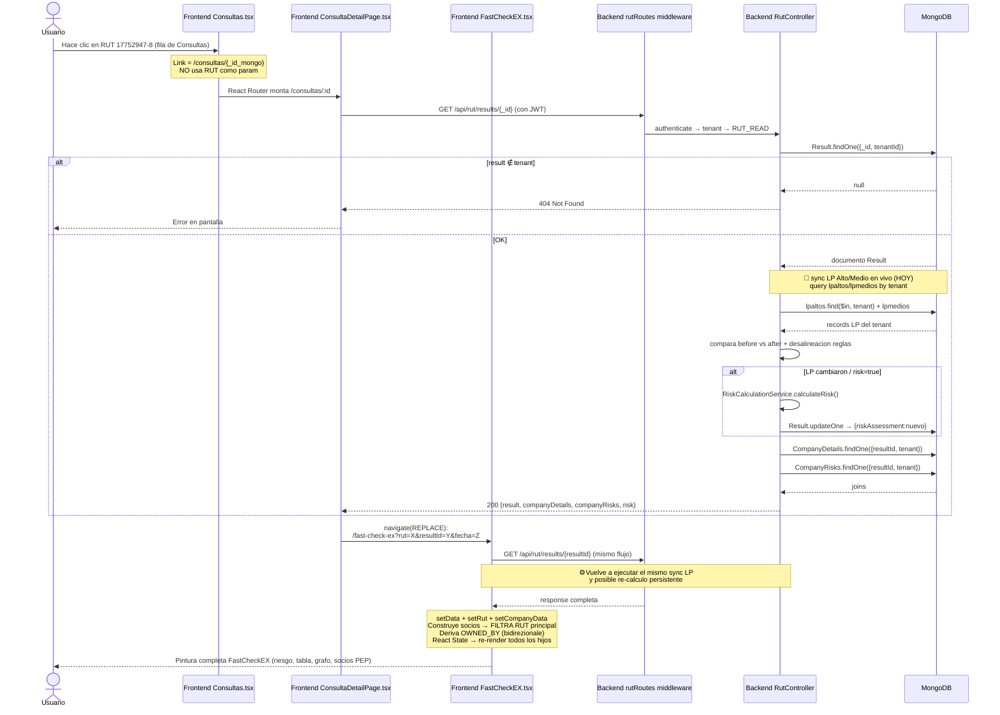

# Flujo: Click sobre RUT en la página Consultas

> Última actualización: 30.09.2026 · Autor: Duxiter Intermediate Team
> Diagrama end-to-end del recorrido desde que el usuario hace clic en un RUT dentro de la tabla "Consultas" hasta que termina renderizado en FastCheckEX con re-sincronización de Listas Propias y re-cálculo de riesgo.

---

## 🔁 Resumen Ejecutivo (1 línea)

```
Click en RUT → <Link to=/consultas/{_id}> → ConsultaDetailPage
            → GET /api/rut/results/{_id} (middleware tenant + permission)
            → navigate(replace) a /fast-check-ex?rut={RUT}&resultId={_id}&fecha={createdAt}
            → FastCheckEX usa resultId, refetch, autosinc LP Alto/Medio
            → re-calculo riskAssessment si LP cambiaron → persistencia DB
            → render completa + Socios Históricos (sin RUT principal)
```

---

## 📑 FASE 1 · Página Consultas (frontend)

**Archivo:** [Consultas.tsx](file:///home/duxiter/duxiter_intermediate/src/pages/Consultas.tsx)

| # | Paso | Detalle | Localización |
|---|------|---------|--------------|
| 1.1 | Carga inicial paginada | `useEffect` → `getResults({page, limit, search})` devuelve 20 filas por página de la colección `results` (solo tenant actual). | [L506-L540](file:///home/duxiter/duxiter_intermediate/src/pages/Consultas.tsx#L506-L540) |
| 1.2 | Búsqueda RUT | `cleanRutForApi()`: si el search input tiene `-`, envía solo el cuerpo al backend (sin DV) para maximizar hits. | [L39-L47](file:///home/duxiter/duxiter_intermediate/src/pages/Consultas.tsx#L39-L47) |
| 1.3 | **Render del link** | ⚠️ El `<Link>` NO usa el RUT como parámetro de ruta. Usa el `_id` mongo del documento Result. Dos puntos de entrada con destino idéntico: **celda RUT** (subrayada) e **icono ojo 👁 de Acciones**. | [L1070-L1072](file:///home/duxiter/duxiter_intermediate/src/pages/Consultas.tsx#L1070-L1072) · [L1097-L1103](file:///home/duxiter/duxiter_intermediate/src/pages/Consultas.tsx#L1097-L1103) |

Fragmento clave:
```tsx
// Celda RUT — link clickeable
<Link to={`/consultas/${result._id}`} className="text-primary-600 hover:underline">
  {result.rut || result.details?.rut}
</Link>
```

---

## 📑 FASE 2 · Router React (client-side routing)

**Archivo:** [App.tsx](file:///home/duxiter/duxiter_intermediate/src/App.tsx)

| # | Paso | Detalle | Localización |
|---|------|---------|--------------|
| 2.1 | Declaración de ruta | Ruta protegida con `<ProtectedRoute>` + `<SuperuserBlockedRoute>` (más adelante en FastCheckEX). | [L86-L92](file:///home/duxiter/duxiter_intermediate/src/App.tsx#L86-L92) |

```tsx
<Route path="/consultas" element={<Consultas />} />
<Route path="/consultas/:id" element={<ConsultaDetailPage />} />
<Route path="/fast-check-ex" element={<SuperuserBlockedRoute><FastCheckEX /></SuperuserBlockedRoute>} />
```

---

## 📑 FASE 3 · ConsultaDetailPage → Redirect "puente" hacia FastCheckEX

**Archivo:** [ConsultaDetailPage.tsx](file:///home/duxiter/duxiter_intermediate/src/pages/ConsultaDetailPage.tsx)

> Componente "bridge": **nunca pinta UI al usuario final** (salvo spinner / error). Su único trabajo es resolver el `_id` → RUT y redirigir al "workhorse" `FastCheckEX` con todos los parámetros URL necesarios.

| # | Paso | Detalle | Localización |
|---|------|---------|--------------|
| 3.1 | Extrae param | `const { id } = useParams<{id:string}>()` — el ID mongo del Result. | [L9](file:///home/duxiter/duxiter_intermediate/src/pages/ConsultaDetailPage.tsx#L9-L9) |
| 3.2 | Fetch Result | `useEffect` → `GET /api/rut/results/${id}` | [L14-L40](file:///home/duxiter/duxiter_intermediate/src/pages/ConsultaDetailPage.tsx#L14-L40) |
| 3.3 | Construye query string | Codifica 3 params: `rut`, `resultId`, `fecha` (ISO `createdAt`). | [L24-L26](file:///home/duxiter/duxiter_intermediate/src/pages/ConsultaDetailPage.tsx#L24-L26) |
| 3.4 | **Redirect replace** | `navigate( /fast-check-ex?rut=…&resultId=…&fecha=… , { replace: true })` <br>⚠️ `replace: true` = **destruye la entrada del historial** de ConsultaDetailPage. Botón atrás del navegador vuelve a `/consultas`, NO a esta página puente. | [L27](file:///home/duxiter/duxiter_intermediate/src/pages/ConsultaDetailPage.tsx#L27-L27) |
| 3.5 | Edge case | Si `result.details.rut` no existe → pinta error "No se encontró el RUT" y se detiene. | [L28-L31](file:///home/duxiter/duxiter_intermediate/src/pages/ConsultaDetailPage.tsx#L28-L31) |

---

## 📑 FASE 4 · Backend — `GET /rut/results/:id`

### 4.1 Declaración de ruta y middlewares

**Archivo:** [rutRoutes.ts L501](file:///home/duxiter/duxiter_intermediate/server/src/routes/rutRoutes.ts#L501-L501)

Pipeline de seguridad por request (en orden):

| Orden | Middleware | Propósito |
|-------|-----------|-----------|
| 1 | `authenticateMw` | Valida Bearer JWT, inyecta `req.user` (userId, tenant, roles) |
| 2 | `tenantFilterMw` | Inyecta `req.tenantId` y asegura scope tenant en agregaciones |
| 3 | `rutReadMw` | `requirePermission(Permission.RUT_READ)` → 403 si no tiene permiso |
| 4 | `RutController.getResultById` | Handler de negocio |

---

### 4.2 Controlador getResultById

**Archivo:** [rutController.ts L1913-L2049](file:///home/duxiter/duxiter_intermediate/server/src/controllers/rutController.ts#L1913-L2049)

| # | Paso | Detalle | Localización |
|---|------|---------|--------------|
| 4.2.1 | **Validación ID** | Si `id` está vacío o = `"undefined"` → HTTP 400. | [L1916-L1918](file:///home/duxiter/duxiter_intermediate/server/src/controllers/rutController.ts#L1916-L1918) |
| 4.2.2 | 🔐 **Aislamiento tenant** | `tenantId = req.user?.tenant`. Si falta → 401. Luego `Result.findOne({ _id: id, tenantId })`. <br>🧱 **Seguridad Hard**: Si intentas cambiar manualmente `?id=` en la URL por un `_id` de OTRO tenant → query retorna `null` y tú recibes un 404. No hay forma de cruzar datos entre tenants. | [L1920-L1929](file:///home/duxiter/duxiter_intermediate/server/src/controllers/rutController.ts#L1920-L1929) |
| 4.2.3 | Decision branch LP sync | Flag `shouldAutoSyncListaPropia = (queryType !== 'derived_socio_pep')`. Las evaluaciones derivadas de soci@ PEP individual NO re-sincronizan LP (no tiene sentido, son records "hijos"). | [L1932](file:///home/duxiter/duxiter_intermediate/server/src/controllers/rutController.ts#L1932-L1932) |
| 4.2.4 | **syncTenantSpecificListaPropiaData** | 3 entradas de RUTs candidatos a comprobar: <br>1) `target.companyGeneralInfo.socios` <br>2) `target.sheriffLogData.companyGeneralInfo.socios` <br>3) `filteredDetails.compliance.sociedades.coincidencias[].socios` <br>→ A cada RUT se le aplica `normalizeRut` + versión con/sin guión → `$in` sobre <br>**`db.lpaltos.find({ rut: { $in: … }, tenant: tenantId })`** y el mismo para `lpmedios`. <br>→ Inyecta resultados en `sheriffLogData.summaryData.data.lpaltosRecords / lpmediosRecords`. | [syncTenantSpecificListaPropiaData L82-L150](file:///home/duxiter/duxiter_intermediate/server/src/controllers/rutController.ts#L82-L150) |
| 4.2.5 | **Snapshots before/after** | Guarda `before.lpaltosDetected`, `before.lpaltosRecordsLen`, `before.lpmediosDetected`, `before.lpmediosRecordsLen` y compara contra `after`. | [L1935-L1970](file:///home/duxiter/duxiter_intermediate/server/src/controllers/rutController.ts#L1935-L1970) |
| 4.2.6 | **Detector de desalineación reglas LP** | Busca en `riskAssessment.allRules.complianceRules` las 2 reglas "Listas Propias Alto Impacto" / "Mediano Impacto" mediante matching de tokens normalizado NFD + strip diacríticos. Compara `detected` vs debería (record count > 0) y también si los `details[]` están vacíos cuando hay data. | [hasLpRulesMismatch L1972-L1994](file:///home/duxiter/duxiter_intermediate/server/src/controllers/rutController.ts#L1972-L1994) |
| 4.2.7 | Trigger re-cálculo riesgo | `listaPropiaChanged || hasLpRulesMismatch || riskRecalc (?risk=true)` <br>→ invoca `RiskCalculationService.calculateRisk(sheriffLogData, motivo)` <br>→ `Result.updateOne({_id}, { riskAssessment: nuevo, sheriffLogData: nuevo })`. <br>**Se PERSISTE el nuevo riesgo en el mismo documento.** | [L2002-L2024](file:///home/duxiter/duxiter_intermediate/server/src/controllers/rutController.ts#L2002-L2024) |
| 4.2.8 | JOIN documentos asociados | `CompanyDetails.findOne({ resultId, tenantId })` + `CompanyRisks.findOne({ resultId, tenantId })`. | [L2031-L2032](file:///home/duxiter/duxiter_intermediate/server/src/controllers/rutController.ts#L2031-L2032) |
| 4.2.9 | Response 200 | `{ ...result.toObject(), companyDetails, companyRisks }` en response JSON. | [L2035-L2041](file:///home/duxiter/duxiter_intermediate/server/src/controllers/rutController.ts#L2035-L2041) |

---

## 📑 FASE 5 · FastCheckEX (render final y hooks)

**Archivo:** [FastCheckEX.tsx](file:///home/duxiter/duxiter_intermediate/src/pages/FastCheckEX.tsx)

| # | Paso | Detalle | Localización |
|---|------|---------|--------------|
| 5.1 | **Parseo URL params** | `useEffect` que escucha `[searchParams]`: <br>`rutParam = searchParams.get('rut')` <br>`resultIdParam = searchParams.get('resultId' / '_id' / 'id')` <br>`resetParam = searchParams.get('reset_evaluacion')`. <br>⚠️ **Regla de precedencia**: Si `resultId` está presente → **SIEMPRE gana** sobre `rutParam` (ruta 4.2). | [L2842-L2856](file:///home/duxiter/duxiter_intermediate/src/pages/FastCheckEX.tsx#L2842-L2856) |
| 5.2 | Branch fetchData() | `if (resultId) → GET /rut/results/${resultId}?risk=…` <br>`else if (searchRut) → GET /rut/results/rut/${searchRut}` <br>`else → GET /rut/results/latest → re-deriva` | [L1454-L1473](file:///home/duxiter/duxiter_intermediate/src/pages/FastCheckEX.tsx#L1454-L1473) |
| 5.3 | Post-procesamiento riesgo | Calcula `buildDimension()` × 4 (compliance / legal / capitalHumano / financieroTributario) → inyecta `response.data.calculation` con totals y detected x categoría. | [L1475-L1520](file:///home/duxiter/duxiter_intermediate/src/pages/FastCheckEX.tsx#L1475-L1520) |
| 5.4 | Deriva relaciones OWNED_BY bidirezionali | `deriveRelations(dequienesRelationships, details.rut)` → injecta `companyGeneralInfo.administradores` desde representantes legales DeQuiénes. | [L1521-L1526](file:///home/duxiter/duxiter_intermediate/src/pages/FastCheckEX.tsx#L1521-L1526) |
| 5.5 | **Carga state core** | `setData(response.data)` → `setRut(companyRut)` → **`setCompanyData({ razonSocial, rut, fechaEvaluacion })`**. <br>⚠️ `fechaEvaluacion` es el `createdAt` / `updatedAt` REAL del documento mongo, NO `new Date()`. | [L1528-L1560](file:///home/duxiter/duxiter_intermediate/src/pages/FastCheckEX.tsx#L1528-L1560) |
| 5.6 | Construcción Socios Históricos | PASSO 1: recopila de 3 fuentes (DeQuiénes > compliance sociedades, mallaSocietariaData.socios, companyGeneralInfo.socios, legalRepresentantes si es Natural). PASSO 2: deduplicación por nombre NFD + merge inteligente RUT. <br>🧷 **FILTRO RUT EVALUACIÓN**: Al final del PASSO 2 `socios.filter(s → rut_principal_no_coincide(s))` 3-fallback (norm / solo dígitos / prefijo 8cifras) → el RUT de la empresa evaluada NUNCA aparece en la lista. | [Construcción L2050-L2268](file:///home/duxiter/duxiter_intermediate/src/pages/FastCheckEX.tsx#L2050-L2268) · [Filtro RUT principal L2270-L2295](file:///home/duxiter/duxiter_intermediate/src/pages/FastCheckEX.tsx#L2270-L2295) |
| 5.7 | Reset evaluaciones socios | Si URL contiene `reset_evaluacion=true` y hay `sociosEvaluations[]` cargados → window.confirm → `POST /rut/reset-socios-evaluations { ruts[], confirm:true }` → borra los EvaluationResult de esos socios en este tenant y limpia flag URL. | [L2858-L2891](file:///home/duxiter/duxiter_intermediate/src/pages/FastCheckEX.tsx#L2858-L2891) |
| 5.8 | Render sub-componentes | Se activan en cascada: tabla general, panel de riesgo, **`<MeshFlowTable>` visible por default** (se oculta solo si URL `?p=true`), **`<Legalrepresentatives>`**, **`<MeshFlowChartOwnedLib>`** React Flow Graph (OWNED_BY), sección Socios PEP con check evaluaciones previas, tablas causas + PDFs descargables. | Véase return JSX ~ [L4300 en adelante](file:///home/duxiter/duxiter_intermediate/src/pages/FastCheckEX.tsx#L4300-L4300) |

---

## 🔐 Nota Crítica sobre Listas Propias (LpAlto / LpMedio)

**La intención funcional (del file `nota.txt` línea 2) es: "ipalto ipmedio deve essere applicato solo nel momento della consulta".**

### Estado actual vs intención

| Modelo | ¿Cuándo se aplica? | Dónde |
|--------|--------------------|-------|
| ⚠️ **Actual (comportamiento HOY)** | **Cada vez que se ABRE/REVISA la consulta almacenada** (click en RUT). <br>El handler `getResultById` re-sincroniza siempre LP en vivo desde `lpaltos/lpmedios` y, si detecta cambios, **sobre-escribe `riskAssessment`** del documento histórico. | [rutController.ts L1932-L2024](file:///home/duxiter/duxiter_intermediate/server/src/controllers/rutController.ts#L1932-L2024) |
| 🎯 **Intención dichiarata en nota** | **Solo en el momento de EJECUTAR la consulta (lookupRut)**. <br>Al abrir una consulta pasada el riesgo debería ser INMUTABLE; las listas del momento de la consulta debieron haber sido snapshot. | Lugar de implementación ideal: [RutController.lookupRut](file:///home/duxiter/duxiter_intermediate/server/src/controllers/rutController.ts) + desactivar el sync en getResultById |

> 🔴 **Impacto funcional actual**: Un RUT que el día 01 dio "Sin Listas Propias → riesgo Bajo", al agregar el RUT a LP Alto en Tenant Admin el día 15, **al re-abrir la consulta del día 01 el semáforo cambia** (el documento histórico original se modifica en DB con un `updateOne`). No hay snapshot temporal de LP en el Result.

---

## 🌐 Diagrama Secuencia Mermaid



---

## 🧭 Archivos Clave Involucrados (quick jump)

| Capa | Ruta | Rol |
|------|------|-----|
| 🖥 UI Tabla Consultas | [Consultas.tsx](file:///home/duxiter/duxiter_intermediate/src/pages/Consultas.tsx) | Lista paginada + filtros + links |
| 🖼 UI Puente | [ConsultaDetailPage.tsx](file:///home/duxiter/duxiter_intermediate/src/pages/ConsultaDetailPage.tsx) | Resuelve _id → redirect FastCheckEX |
| 🌳 Router App | [App.tsx](file:///home/duxiter/duxiter_intermediate/src/App.tsx) | Declaración rutas /consultas, /fast-check-ex |
| ⚙️ UI Workhorse | [FastCheckEX.tsx](file:///home/duxiter/duxiter_intermediate/src/pages/FastCheckEX.tsx) | Render final + hooks data flow |
| 🛰 Backend rutas | [rutRoutes.ts](file:///home/duxiter/duxiter_intermediate/server/src/routes/rutRoutes.ts) | Middleware pipeline REST |
| 🧠 Backend negocio | [rutController.ts](file:///home/duxiter/duxiter_intermediate/server/src/controllers/rutController.ts) | Lookup, Results, sync LP, re-calc riesgo |
| 💿 Esquema Result | [Result.ts](file:///home/duxiter/duxiter_intermediate/server/src/models/Result.ts) | Schema Mongoose colección `results` |
| 🎯 Canonical RUT (backend) | [rutCanonical.ts](file:///home/duxiter/duxiter_intermediate/server/src/helpers/rutCanonical.ts) | Desambiguación 7/8 cifras sin DV con Mod-11 |
| 🎯 Canonical RUT (frontend) | [rutCanonical.ts](file:///home/duxiter/duxiter_intermediate/src/helpers/rutCanonical.ts) | Misma lógica, lado cliente |
